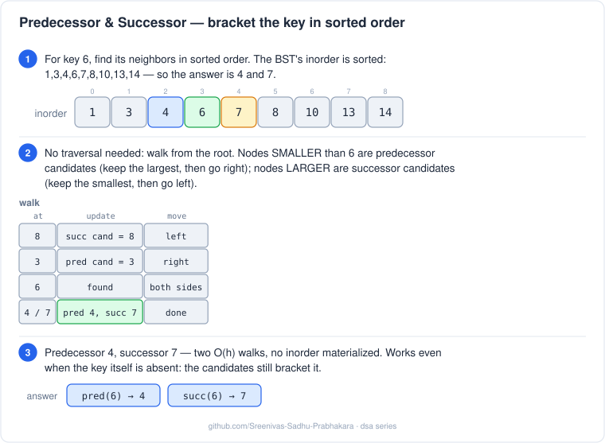

# Inorder Predecessor / Successor in BST

> Striver SDE Sheet 137 · Day 20 BST — two candidate-keeping descents: record the node each time the search is forced past it. Go, stdlib only, tested.

## Problem

For a key (present or not), find its inorder neighbors in a BST: the largest value strictly below it and the smallest strictly above it.

## Approach

No parent pointers, no traversal: descend from the root twice. Hunting the predecessor, every time the current node is *smaller* than the key, it's a candidate — but a larger-yet-still-smaller value might hide in its right subtree, so record it and go right; otherwise go left. The last recorded candidate is exact. The successor descent mirrors it. The "record when forced past" idea is the loop-invariant version of "the predecessor is the rightmost node you stepped right from" — and it handles absent keys, minima and maxima with zero special cases, which the tests exercise.

**Complexity:** O(h) time per neighbor, O(1) space.

## Visual walkthrough

Read the picture top to bottom — each numbered frame is one moment of the algorithm
running on this repo's test example.

## Run

    go test ./...   # verify
    go run .        # demo

---

One of 191 repos solving Striver's SDE Sheet in Go — stdlib only, one problem per repo, every solution tested. Browse the set: [`dsa-*` repos](https://github.com/Sreenivas-Sadhu-Prabhakara?tab=repositories&q=dsa-&type=source).
